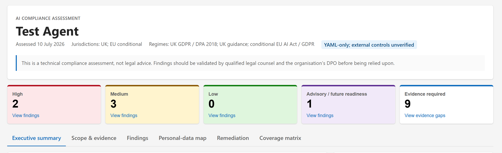

# Copilot Studio AI Compliance Skill

An agent skill that assesses a **Microsoft Copilot Studio agent** for compliance with AI legislation. Point it at an unpacked agent (the local YAML produced by cloning an agent) and it produces a severity-ranked compliance report.



## What it does

1. **Establishes jurisdiction from operational facts** — where the organisation is established, which users are targeted, where output is used, and whether access is geographically restricted. EU AI Act and GDPR extraterritorial scope are tested separately rather than inferred from UK operation alone.
2. **Inventories source and external evidence** — `agent.mcs.yml`, settings, topics, actions, variables and connections, plus available tenant/runtime controls such as transcripts, authentication, data policies, connector credentials, channels and retention. It labels YAML-only assessments as incomplete.
3. **Classifies the agent** under the EU AI Act (provider vs deployer role, prohibited / high-risk / limited / minimal tier) and the UK's five cross-sector AI principles.
4. **Applies requirement gates** across the EU AI Act, UK AI principles, EU/UK GDPR & DPA 2018, consumer and equality law, and platform controls. Each item records its basis type, applicability, effective status, and evidence status before it is scored.
5. **Outputs a self-contained Fluent UI-style HTML dashboard** with:
   - a first-viewport header and severity tiles in the order High, Medium, Low, followed by Advisory / future readiness and Evidence required
   - accessible tabs for Executive summary, Scope & evidence, Findings, Personal-data map, Remediation, and Coverage matrix
   - responsive finding cards, evidence states, official links, and a print-friendly layout
   - a Markdown fallback only when HTML generation is unavailable
   - **High / Medium / Low** findings for current binding-law or material technical risks, with separate **Advisory / future readiness** items
   - a basis type for every item: binding law, future obligation, regulatory guidance, or technical control
   - separate tenant/runtime and organisational evidence requests rather than treating unavailable external controls as YAML defects
   - a coverage-matrix appendix as the audit trail that every in-scope requirement was checked

> ⚠️ **Disclaimer:** this produces a technical compliance assessment, not legal advice. Findings should be validated by qualified legal counsel and your DPO before being relied upon.

## Repository structure

```
SKILL.md                        # the skill definition (Agent Skills format)
resources/
  eu-legislation.md             # EU AI Act, EU GDPR, UCPD, EAA — with EUR-Lex links
  uk-legislation.md             # UK AI principles, UK GDPR/DPA 2018, DUAA 2025, Equality Act, DMCC — with legislation.gov.uk/ICO links
  copilot-studio-controls.md    # Runtime evidence surfaces and Microsoft Learn links
assets/
  report-template.html          # Self-contained Fluent UI-style dashboard template
  report-screenshot.png         # Example report dashboard (shown above)
evals/
  cases.json                    # Regression scenarios for scope, applicability, severity and evidence
scripts/
  validate-skill.ps1           # Deterministic content-contract checks
```

## Prerequisite: clone your agent locally

The skill works on the **unpacked YAML source** of a Copilot Studio agent — a folder containing `agent.mcs.yml`, `settings.mcs.yml`, and `topics/`, `actions/`, `variables/` subfolders.

### Option A — Microsoft Copilot Studio extension for VS Code

1. Install the **Microsoft Copilot Studio** extension from the VS Code marketplace.
2. Sign in with an account that has access to the Power Platform environment hosting the agent.
3. Open the Command Palette (`Ctrl+Shift+P`) → **Copilot Studio: Clone agent** (or use the Copilot Studio panel).
4. Pick the environment, pick the agent, and choose a local folder.
5. You should end up with a structure like:

```
MyAgent/
  agent.mcs.yml
  settings.mcs.yml
  connectionreferences.mcs.yml
  topics/*.mcs.yml
  actions/*.mcs.yml
  variables/*.mcs.yml
```

### Option B — Claude Code with the Copilot Studio plugin

If you use the Copilot Studio plugin for Claude Code, run:

```
/copilot-studio:clone-agent
```

and follow the prompts (environment selection → agent selection → local folder).

## Running the skill in Claude Code

1. Copy this repo's contents into a skills folder:
   - **Personal (all projects):** `~/.claude/skills/copilot-studio-ai-compliance/`
   - **Project-scoped:** `<your-repo>/.claude/skills/copilot-studio-ai-compliance/`

   ```powershell
   git clone https://github.com/jsl1995/copilot-studio-ai-compliance "$env:USERPROFILE\.claude\skills\copilot-studio-ai-compliance"
   ```

   ```bash
   git clone https://github.com/jsl1995/copilot-studio-ai-compliance ~/.claude/skills/copilot-studio-ai-compliance
   ```

2. Start Claude Code in (or navigate to) the folder containing your unpacked agent.
3. Invoke the skill:

   ```
   /copilot-studio-ai-compliance
   ```

   or just ask naturally: *"Run an AI compliance review of this agent."*

4. Answer the jurisdiction and operational-scope questions when prompted, then review the HTML dashboard. The skill will offer to save it as `ai-compliance-report.html`; it only uses `ai-compliance-report.md` as a fallback or companion when requested.

## Running the skill in GitHub Copilot

GitHub Copilot (VS Code) has rolling support for the Agent Skills format; where it isn't available yet, the prompt-file route below works everywhere.

### Option A — Agent Skills support (where available)

Copy the skill into your repository so Copilot's agent mode can discover it:

```
<your-repo>/.github/skills/copilot-studio-ai-compliance/SKILL.md
<your-repo>/.github/skills/copilot-studio-ai-compliance/resources/...
```

Then, in Copilot Chat (Agent mode), ask: *"Assess this agent for AI legislation compliance using the copilot-studio-ai-compliance skill."*

### Option B — Prompt file (works today in any Copilot Chat)

1. Copy `SKILL.md` and the `resources/` folder into your repo, e.g. under `.github/prompts/`, renaming `SKILL.md` to `copilot-studio-ai-compliance.prompt.md` (keep `resources/` next to it and strip the YAML frontmatter if Copilot complains).
2. Open your unpacked agent folder in VS Code.
3. In Copilot Chat run the prompt file (`/copilot-studio-ai-compliance` in chat, or attach it via *Add Context → Prompt…*), or simply attach `SKILL.md` as context (`#file`) and say: *"Follow these instructions to assess the agent in this workspace."*

Notes for Copilot users:

- The skill's interactive region question becomes a plain chat question — answer it in the conversation.
- For regions other than UK/EU the skill relies on web research; enable Copilot's web search tool (`#fetch`/web search in agent mode) or supply the relevant legislation yourself.

## Example findings (from a real assessment)

| Severity | Finding | Legislation |
|---|---|---|
| Contextual | No AI disclosure | Article 50 shortfall only when territorial scope, responsible role, effective date and the interaction test establish the duty; otherwise future readiness or guidance |
| Contextual | Placeholder escalation address | Binding-law severity only where an applicable redress or automated-decision safeguard requires it; otherwise a technical or guidance gap |
| Technical | Low moderation on a public agent | Risk-rate against audience, use case and tested safety controls; do not present the setting alone as a statutory breach |
| Contextual | Automated rejection without human review | Apply automated-decision law only when the decision is solely automated and legally or similarly significant |

## Keeping it current

The reference files were updated in **July 2026**. EU AI Act obligations phase in through 2027 and UK legislation and guidance continue to evolve. The skill requires current official-source verification of territorial scope, commencement and amendments before formal deliverables, and live research for jurisdictions beyond the EU/UK.
